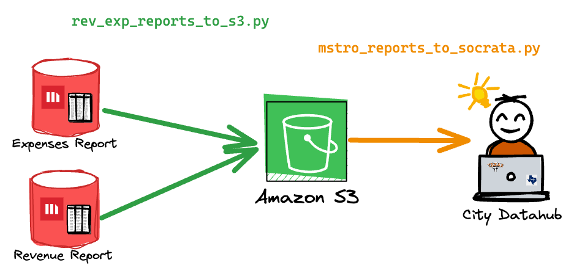

# TPW Finance Reporting

This repo stores python scripts that gathers financial reports from MicroStrategy and parses them to publish data to the City Datahub.

## rev_exp_reports_to_socrata.py

This ETL script is for running any non-prompted MicroStrategy report, applying transformations, then publishing it to the City Datahub AKA Socrata.

**`rev_exp_reports_to_socrata.py` will replace all the data in Socrata every time you run it.** 

To run one report and update the data in Socrata:

```bash
python etl/microstrategy_to_socrata.py --report sif_spent
```
To configure a new report:
1. Get the report ID from MicroStrategy, the simplest way is to right-click on the report then go to properties → Report ID
2. Create a dataset in Socrata to receive the data. If you utilize the `snake_case_keys` transformation, the field names will become lower cased and underscored
3. Add a new entry into `etl/config.py` with the dataset ID and report ID and add the transformations you would like to add

To add a new transformation:
1. Add it as a function in `etl/microstrategy_to_socrata.py`, it will need to accept a `rows` argument, at minimum.
2. Add it to the dict at the bottom of the script called `TRANSFORMS`
3. Reference it in your report config in `config.py`, if there are no parameters, do not supply a `params` key.

## Revenue/Expenses Reports

The scripts stored at `etl/revenue_expenses` are for running MicroStrategy reports for gathering the total expenses and revenue for
TPW workgroups. It is visualized on an internal facing finances dashboard. 



### rev_exp_reports_to_socrata.py

This script downloads two finance reports (expenses and revenue) from MicroStrategy then uploads them as CSVs to an Amazon S3 bucket. Without any parameters, the script will download the report for the current month and the previous month. Each month's report is ran with the date set to the last date of the month. 

Download the report for the current month and previous month:

```bash
python etl/revenue_expenses/rev_exp_reports_to_socrata.py
```

Download the report for May 2024 & April 2024:

```bash
python etl/revenue_expenses/rev_exp_reports_to_socrata.py --year 2024 --month 5
```

Fully replace all the data stored in socrata: 

```bash
python etl/revenue_expenses/rev_exp_reports_to_socrata.py --replace True
```

### rev_exp_report_to_s3.py

This script downloads the CSVs stored in the S3 bucket, transforms the data, and upserts it to the City Data Hub (socrata). Similar to `mstro_reports_to_socrata.py`, it'll upload the current month and previous month's data without any script parameters.

Run the report for the current month and the previous month:

```bash
python etl/revenue_expenses/rev_exp_report_to_s3.py
```

Run the report for May and April 2024:

```bash
python etl/revenue_expenses/rev_exp_report_to_s3.py --year 2024 --month 5
```

## Docker

This repo can be used with a docker container. You can either build it yourself with:

```bash
docker build . -t atddocker/dts-finance-reporting:production
```

or pull from our dockerhub account:

```bash
docker pull atddocker/dts-finance-reporting:production`
```

Then, provide the environment variables described in env_template to the docker image:

```bash
docker run -it --env-file env_file atddocker/dts-finance-reporting:production /bin/bash
``` 

Then, provide the command you would like to run.
